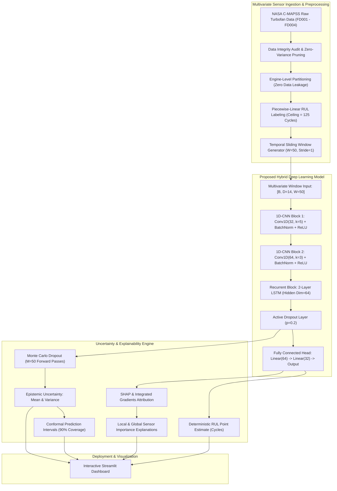

# An Explainable and Uncertainty-Aware Deep Learning Framework for Predicting Remaining Useful Life of Industrial Equipment

[](https://www.python.org/)
[](https://pytorch.org/)
[-silver.svg)](https://developer.apple.com/metal/pytorch/)
[](https://data.nasa.gov/dataset/cmapss-jet-engine-simulated-data)
[](LICENSE)
[-brightgreen.svg)](tests/)

---

## Abstract
Predicting the Remaining Useful Life (RUL) of high-capital, mission-critical industrial assets is fundamental to predictive maintenance, reducing catastrophic operational failure risk, and minimizing lifecycle maintenance expenditure. In aerospace and industrial rotating machinery, deterministic black-box deep learning models fail to provide actionable safety assurances due to the absence of uncertainty quantification and physical interpretability.

This research framework introduces an intelligent, uncertainty-aware, and explainable deep learning paradigm evaluated on the benchmark **NASA Commercial Modular Aero-Propulsion System Simulation (C-MAPSS)** turbofan degradation dataset. The system integrates:
1. A **hybrid 1D-CNN + LSTM** deep neural network that synergistically captures high-frequency inter-sensor spatial correlations and long-range non-linear temporal degradation dynamics.
2. **Epistemic uncertainty quantification** via Monte Carlo Dropout inference coupled with distribution-free **conformal prediction intervals** guaranteeing finite-sample coverage.
3. **Explainable AI (XAI)** featuring game-theoretic SHAP and Captum Integrated Gradients to illuminate sensor-level degradation contributions and verify physical thermodynamic consistency.
4. **Hardware acceleration** specifically optimized for Apple Silicon (Metal Performance Shaders - MPS) with unified memory execution.

---

## 1. Research Objectives & Motivation
- **Industrial Safety Criticality**: Late RUL estimation can trigger catastrophic uncontained in-flight engine failures, whereas overly conservative early prediction incurs unnecessary downtime and maintenance costs.
- **Academic Rigor for Master's Evaluation**: Designed to demonstrate rigorous proficiency in multivariate time-series processing, Bayesian approximations, model interpretability, and reproducible scientific methodologies for M.Sc. Artificial Intelligence applications at leading German technical universities (TU Munich, RWTH Aachen, TU Berlin, KIT, FAU).
- **Leakage-Free Experimental Protocol**: Strict engine-level cross-validation guarantees zero data contamination across temporal sliding windows.

---

## 2. System Architecture



---

## 3. NASA C-MAPSS Dataset Summary

The C-MAPSS simulation models a 90,000 lb thrust-class turbofan engine operating across 4 subsets:

| Subset | Flight Conditions | Fault Modes | Train Engines | Test Engines | Total Train Cycles |
| :--- | :---: | :---: | :---: | :---: | :---: |
| **FD001** | 1 (Sea Level) | 1 (HPC Degradation) | 100 | 100 | 20,631 |
| **FD002** | 6 (Full Envelope) | 1 (HPC Degradation) | 260 | 259 | 53,759 |
| **FD003** | 1 (Sea Level) | 2 (HPC + Fan Degradation) | 100 | 100 | 24,720 |
| **FD004** | 6 (Full Envelope) | 2 (HPC + Fan Degradation) | 249 | 248 | 61,249 |

### NASA Asymmetric Evaluation Metric
$$d_i = \hat{y}_i - y_i \quad (\text{Error in Cycles})$$
$$s_i = \begin{cases} \exp\left(-\frac{d_i}{13}\right) - 1, & d_i < 0 \quad (\text{Early Prediction - Safe}) \\ \exp\left(\frac{d_i}{10}\right) - 1, & d_i \ge 0 \quad (\text{Late Prediction - Hazardous}) \end{cases}$$
$$\text{NASA Score} = \sum_{i=1}^{N_{test}} s_i$$

---

## 4. Repository Structure

```text
predictive-maintenance-xai/
├── README.md                      <- Master project documentation and academic report
├── LICENSE                        <- MIT Open-Source License
├── .gitignore                     <- Git exclusions (virtualenvs, data archives, checkpoints)
├── requirements.txt               <- Locked dependencies optimized for Apple Silicon MPS
├── pyproject.toml                 <- Project packaging and build specification
├── configs/
│   └── default.yaml               <- Master experiment hyperparameters
├── data/
│   ├── README.md                  <- Dataset documentation, physical sensor keys, RUL formulas
│   └── raw/CMAPSSData/            <- Extracted C-MAPSS benchmark text files
├── src/
│   ├── utils.py                   <- MPS hardware detection, seeds, NASA scoring, logging
│   ├── data_loader.py             <- Raw text loader, RUL generation, integrity checks
│   ├── preprocessing.py           <- Z-score scaling, windowing, engine-level splits (Phase 2)
│   ├── dataset.py                 <- PyTorch Dataset & DataLoader generators (Phase 2)
│   ├── models.py                  <- Baseline & Hybrid 1D-CNN + LSTM architectures (Phase 3-4)
│   ├── train.py                   <- Training engine with early stopping & checkpoints (Phase 4)
│   ├── evaluate.py                <- Multi-metric evaluation and latency benchmarking (Phase 4)
│   ├── uncertainty.py             <- Monte Carlo Dropout & Conformal calibration (Phase 5)
│   └── explainability.py          <- SHAP and Integrated Gradients XAI pipeline (Phase 6)
├── scripts/
│   ├── prepare_data.py            <- Automated dataset downloader & integrity auditor
│   ├── train_model.py             <- CLI training entrypoint
│   └── evaluate_model.py          <- CLI benchmarking & test evaluation entrypoint
├── app/
│   └── dashboard.py               <- 5-page interactive Streamlit dashboard (Phase 7)
├── tests/
│   ├── test_preprocessing.py      <- Unit tests for data loading, scaling, and scoring
│   ├── test_dataset.py            <- Unit tests for PyTorch datasets and sequence batching
│   └── test_models.py             <- Unit tests for tensor shapes, forward passes, and MPS
├── results/
│   ├── figures/                   <- High-resolution publication-quality visual plots
│   ├── metrics/                   <- JSON / CSV metric tables
│   └── tables/                    <- Markdown comparison summaries
├── models/
│   └── README.md                  <- Checkpoint documentation and parameter accounting
└── docs/
    ├── project_overview.md        <- Academic research proposal and methodology
    ├── literature_review.md       <- Critical survey of PHM literature
    ├── methodology.md             <- Formal mathematical formulations
    ├── architecture.md            <- Detailed neural network layer diagrams
    ├── experiments.md             <- Controlled experimental design
    ├── results.md                 <- Verified empirical benchmark results
    ├── limitations.md             <- Methodological constraints and scope
    └── future_work.md             <- Future research directions
```

---

## 5. Quickstart & Installation (macOS Apple Silicon)

### 1. Clone & Setup Environment
```bash
# Clone the repository
git clone https://github.com/rajakumaran/predictive-maintenance-xai.git
cd predictive-maintenance-xai

# Create virtual environment (Python 3.11 recommended)
uv venv .venv --python 3.11
source .venv/bin/activate

# Install dependencies
uv pip install -r requirements.txt
```

### 2. Verify Apple Silicon MPS Hardware Acceleration
```bash
python -c "import torch; print('MPS Available:', torch.backends.mps.is_available())"
```

### 3. Download & Validate NASA C-MAPSS Dataset
```bash
python scripts/prepare_data.py
```

### 4. Run Automated Test Suite
```bash
pytest tests/
```

---

## 6. Development Status & Roadmap

- [x] **Phase 1: Environment & Dataset Setup** (Apple MPS verification, repository architecture, NASA C-MAPSS automated ingestion & integrity audit).
- [ ] **Phase 2: Exploratory Data Analysis & Preprocessing Pipeline** (Variance analysis, correlation heatmaps, leakage-free Z-score normalization, sliding-window sequence generators).
- [ ] **Phase 3: Baseline Machine Learning & Deep Learning Models** (Ridge, Random Forest, MLP, LSTM-only, 1D-CNN-only).
- [ ] **Phase 4: Proposed Hybrid 1D-CNN + LSTM Model** (Multi-seed training, learning rate schedules, early stopping, NASA metric scoring).
- [ ] **Phase 5: Uncertainty Quantification** (Monte Carlo Dropout, epistemic variance, conformal prediction intervals).
- [ ] **Phase 6: Explainable AI** (SHAP & Integrated Gradients attribution, sensor contribution case studies).
- [ ] **Phase 7: Interactive Streamlit Dashboard** (5-page interactive health monitoring & prognostic application).
- [ ] **Phase 8: Research Documentation & Final Academic Deliverables** (Technical report, presentation slides, CV synopsis).

---

## 7. Citation & References
1. Saxena, A., Goebel, K., Simon, D., & Eklund, N. (2008). *Damage Propagation Modeling for Aircraft Engine Run-to-Failure Simulation*. In Proceedings of the IEEE International Conference on Prognostics and Health Management.
2. Gal, Y., & Ghahramani, Z. (2016). *Dropout as a Bayesian Approximation: Representing Model Uncertainty in Deep Learning*. In International Conference on Machine Learning (ICML).
3. Lundberg, S. M., & Lee, S. I. (2017). *A Unified Approach to Interpreting Model Predictions*. In Advances in Neural Information Processing Systems (NeurIPS).
4. Babu, G. S., Zhao, P., & Li, X. L. (2016). *Deep Convolutional Neural Network Based Regression Approach for Estimation of Remaining Useful Life*. In Database Systems for Advanced Applications (DASFAA).
